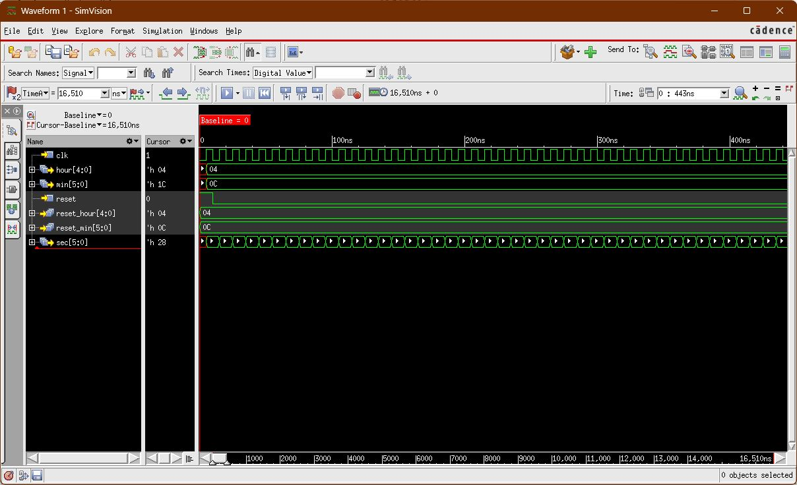
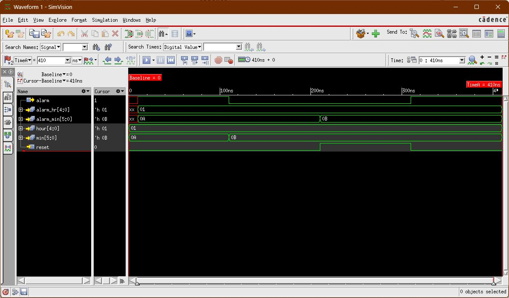
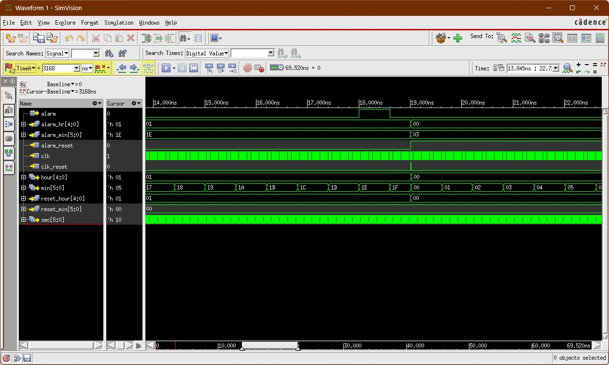
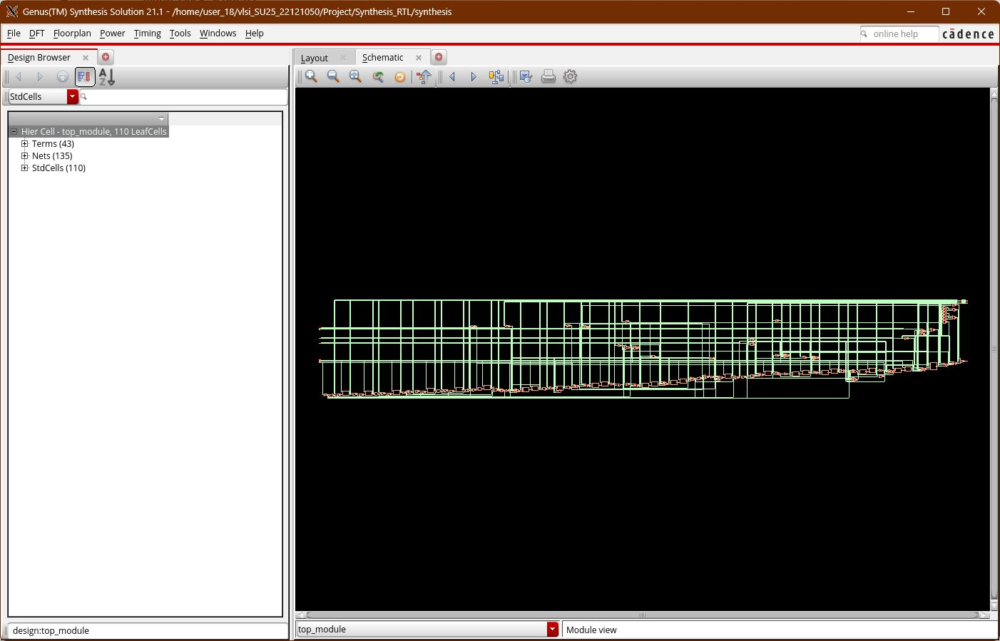
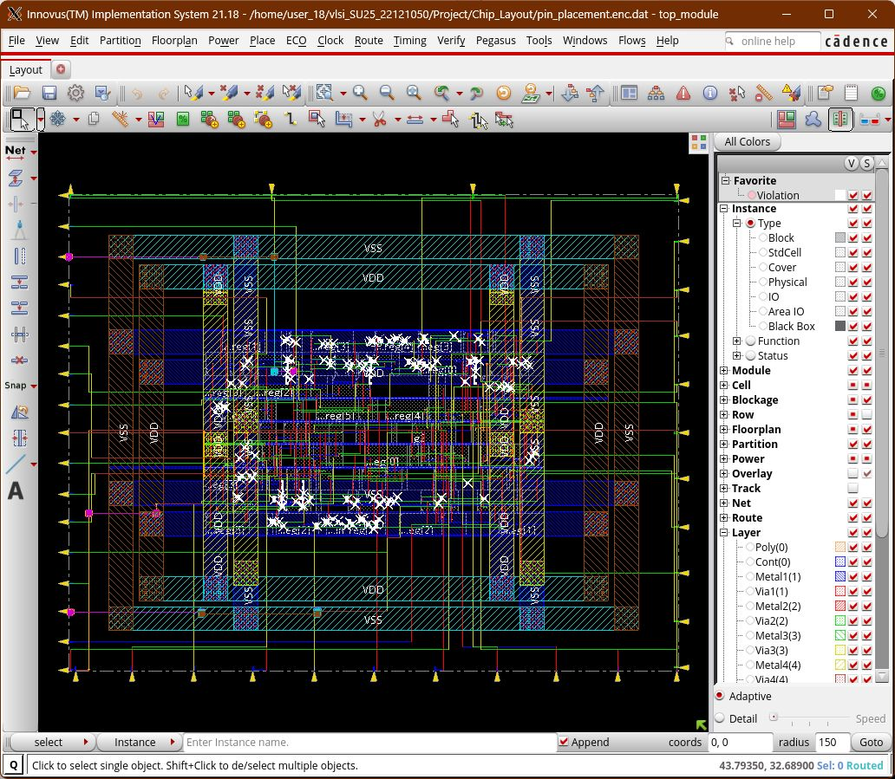
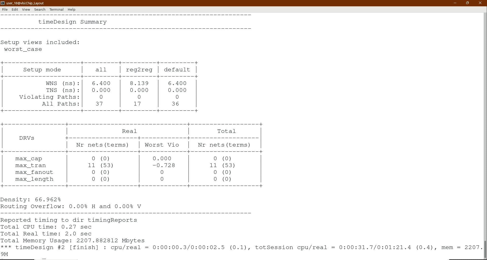

# Design of a Digital Alarm Clock in Verilog HDL

[](https://en.wikipedia.org/wiki/Verilog)
[](https://www.cadence.com/)
[](#rtl-synthesis-results)
[](#physical-design--innovus-implementation)
[](LICENSE)

An ASIC design of a real-time digital alarm clock engineered and verified using **Verilog HDL**, synthesized using **Cadence RTL Compiler / Genus**, and laid out with clean DRC sign-off using **Cadence Innovus**. 

This project was developed for the **EEE411L: VLSI Design Laboratory** course (Summer 2025).

---

## 📑 Table of Contents
1. [Project Objectives](#-project-objectives)
2. [System Architecture & Block Diagram](#-system-architecture--block-diagram)
3. [Module Breakdown](#-module-breakdown)
   - [1. Clock Core (`clock_module.v`)](#1-clock-core-clock_modulev)
   - [2. Alarm Comparator (`alarm_comparator.v`)](#2-alarm-comparator-alarm_comparatorv)
   - [3. Top-Level Integration (`top_module.v`)](#3-top-level-integration-top_modulev)
4. [Signal Interface](#-signal-interface)
5. [Simulation & Waveform Verification](#-simulation--waveform-verification)
6. [RTL Synthesis Results (Cadence)](#-rtl-synthesis-results-cadence)
7. [Physical Design & Layout (Innovus)](#-physical-design--layout-innovus)
8. [Directory Structure](#-directory-structure)
9. [How to Run Simulation](#-how-to-run-simulation)

---

## 🎯 Project Objectives

- **Digital Timekeeping**: Design a robust digital clock that accurately tracks and displays hours ($00-23$), minutes ($00-59$), and seconds ($00-59$).
- **Custom Preset & Reset**: Provide user-programmable initialization inputs (`reset_hour`, `reset_min`) upon asserting system reset.
- **Configurable Alarm System**: Implement a comparator that triggers an active alarm flag when the current time reaches the programmed alarm time (`alarm_hr`, `alarm_min`) and holds it active for exactly 1 minute before auto-clearing.
- **Front-to-Back VLSI Flow**:
  - RTL design and module-level testbench verification in Verilog HDL.
  - Logic synthesis using Cadence RTL synthesis tools targeting `PVT_0P9V_125C` library.
  - Static Timing Analysis (STA), power dissipation, and area estimation.
  - Physical design, floorplanning, placement, and routing (PnR) in Cadence Innovus with zero DRC violations.

---

## 🏛️ System Architecture & Block Diagram

The system comprises two core modules integrated inside a top-level hierarchy:

```
                      +-----------------------------------------------------------+
                      |                        TOP MODULE                         |
                      |                                                           |
                      |   +-----------------------+     hour [4:0]                |
                      |   |                       |===========================>   |
    clk ------------->|-->|                       |     min  [5:0]                |
clk_reset ----------->|-->|     CLOCK MODULE      |===========================>   |
reset_min [5:0] ----->|-->|                       |     sec  [5:0]                |
reset_hour [4:0] ---->|-->|   (Sec, Min, Hour     |===========================>   |
                      |   |    Counters)          |--+                            |
                      |   +-----------------------+  | hour [4:0]                 |
                      |                              | min  [5:0]                 |
                      |                              v                            |
                      |   +-----------------------+<-+                            |
alarm_reset --------->|-->|                       |                               |
alarm_hr [4:0] ------>|-->|   ALARM COMPARATOR    |                               |
alarm_min [5:0] ----->|-->|                       |                               |
                      |   |   (Time Match &       |------------> alarm            |
                      |   |    1-Min Hold Logic)  |                               |
                      |   +-----------------------+                               |
                      +-----------------------------------------------------------+
```

---

## 🧩 Module Breakdown

### 1. Clock Core (`clock_module.v`)
- Synchronous counter operating on `posedge clk`.
- When `reset` is asserted, `sec` is cleared to `0`, while `min` and `hour` are initialized to `reset_min` and `reset_hour`.
- Counts seconds ($0 \rightarrow 59$), minutes ($0 \rightarrow 59$), and hours ($0 \rightarrow 23$) with synchronous rollover.

### 2. Alarm Comparator (`alarm_comparator.v`)
- Evaluates the current clock time against target registers `alarm_hr` and `alarm_min`.
- When `(hour == alarm_hr) && (min == alarm_min)`, the `alarm` output goes HIGH (`1'b1`).
- Remains active throughout the matching minute and automatically shuts off when the minute increments (`min != alarm_min`).
- Includes an independent `reset` line that immediately disables the alarm output regardless of match conditions.

### 3. Top-Level Integration (`top_module.v`)
- Connects the synchronous clock core and alarm comparator into a unified interface ready for synthesis and FPGA/ASIC implementation.

---

## 🔌 Signal Interface

| Port Name | Direction | Bit Width | Description |
|:---|:---:|:---:|:---|
| `clk` | Input | 1 | Master system clock |
| `clk_reset` | Input | 1 | Clock reset (presets clock to `reset_hour`:`reset_min`:00) |
| `alarm_reset` | Input | 1 | Alarm reset / disable signal |
| `reset_min` | Input | 6 | Preset value for minutes ($0-59$) |
| `reset_hour` | Input | 5 | Preset value for hours ($0-23$) |
| `alarm_hr` | Input | 5 | Target alarm hour ($0-23$) |
| `alarm_min` | Input | 6 | Target alarm minute ($0-59$) |
| `sec` | Output | 6 | Current seconds ($0-59$) |
| `min` | Output | 6 | Current minutes ($0-59$) |
| `hour` | Output | 5 | Current hours ($0-23$) |
| `alarm` | Output | 1 | Active-high alarm indicator flag |

---

## 🔬 Simulation & Waveform Verification

### 1. Clock Module Simulation
- **Reset Behavior**: When `reset` is pulsed HIGH, internal counters load the preset values (`hour = 4`, `min = 12`, `sec = 0`).
- **Counting Sequence**: Upon releasing `reset`, seconds count up monotonically $0 \rightarrow 59$, triggering minutes to increment, which in turn rolls over hours after 60 minutes.



### 2. Alarm Comparator Simulation
- Demonstrates asserting `alarm` flag when `(hour, min) == (alarm_hr, alarm_min)`.
- Deasserts immediately when `min` changes or when `reset` is triggered.



### 3. Top Module Integrated Verification
- **Scenario A (Alarm at 01:30)**: System initializes at `01:00:00`. Once time reaches `01:30:00`, the `alarm` flag fires HIGH and stays active for 1 full minute until `01:31:00`.
- **Scenario B (Alarm at 00:03 with Alarm Reset)**: Shows that while `alarm_reset` is active, the alarm flag is suppressed even when clock time matches target alarm time.




---

## 📊 RTL Synthesis Results (Cadence)

Target Library: **PVT_0P9V_125C** (Standard Cell Library)  
Wireload Model: **Enclosed**



### Area Breakdown
| Parameter | Value |
|:---|:---|
| **Module** | `top_module` |
| **Sequential Instances** | 17 |
| **Combinational Instances** | 93 |
| **Total Leaf Instances** | 110 |
| **Cell Area** | **237.35 $\mu\text{m}^2$** |
| **Net Area** | 0.00 $\mu\text{m}^2$ |
| **Total Area** | **237.35 $\mu\text{m}^2$** |

### Power Dissipation Report
| Category | Leakage (W) | Internal (W) | Switching (W) | Total (W) | Percentage |
|:---|:---:|:---:|:---:|:---:|:---:|
| **Register** | $1.86 \times 10^{-9}$ | $3.29 \times 10^{-6}$ | $1.10 \times 10^{-7}$ | $3.41 \times 10^{-6}$ | **72.5%** |
| **Logic** | $3.19 \times 10^{-9}$ | $7.37 \times 10^{-7}$ | $2.79 \times 10^{-7}$ | $1.02 \times 10^{-6}$ | **21.7%** |
| **Clock** | 0.00 | 0.00 | $2.75 \times 10^{-7}$ | $2.75 \times 10^{-7}$ | **5.9%** |
| **Total** | **$5.05 \text{ nW}$** | **$4.03 \ \mu\text{W}$** | **$6.64 \times 10^{-7} \text{ W}$** | **$4.70 \ \mu\text{W}$** | **100.0%** |

### Timing & Slack Analysis (QoR)
- **Target Clock Period**: $10,000\text{ ps}$ ($10\text{ ns}$ / $100\text{ MHz}$)
- **Data Path Delay**: $737\text{ ps}$
- **Final Arrival Time**: $1,737\text{ ps}$
- **Critical Path Slack**: **$+7,253\text{ ps}$** (Setup Timing MET with substantial margin)
- **Total Negative Slack (TNS)**: **$0.0\text{ ps}$**
- **Max Fanout**: 17 (`clk`)

---

## 📐 Physical Design & Layout (Innovus)

Floorplanning and place-and-route was carried out in **Cadence Innovus**:
- Complete pin placement with optimized core-to-die margin.
- Zero DRC violations across all metal routing layers (`Metal1` through `Metal9`).
- Zero process antenna violations.




---

## 📁 Directory Structure

```text
digital-alarm-clock/
├── rtl/                                  # RTL Source Files
│   ├── clock_module.v                    # Real-time counter logic
│   ├── alarm_comparator.v                # Alarm comparison logic
│   └── top_module.v                      # System top-level module
├── tb/                                   # Testbenches
│   ├── clock_tb.v                        # Clock unit testbench
│   ├── alarm_comparator_tb.v             # Comparator testbench
│   └── top_module_tb.v                   # Full system testbench
├── reports/                              # Cadence Synthesis & Innovus Reports
│   ├── area_report.txt                   # Area breakdown
│   ├── power_report.txt                  # Power breakdown
│   ├── qor_report.txt                    # Quality of Result metrics
│   ├── timing_report.txt                 # STA timing path & slack
│   └── innovus_time_design_summary.txt   # Innovus DRC sign-off
├── docs/                                 # Documentation & Assets
│   ├── Design_of_a_Digital_Alarm_Clock_EEE411L.pdf  # Downloaded presentation deck
│   └── assets/                           # Waveforms, schematics & layout images
├── .gitignore
└── README.md
```

---

## 🚀 How to Run Simulation

### Option A: Using Icarus Verilog & GTKWave
```bash
# Compile and run the top-level testbench
iverilog -o sim_top rtl/clock_module.v rtl/alarm_comparator.v rtl/top_module.v tb/top_module_tb.v
vvp sim_top

# View waveforms
gtkwave top_module_tb.vcd
```

### Option B: Using AMD Vivado
```bash
# Run batch simulation in Vivado
xvlog rtl/*.v tb/top_module_tb.v
xelab top_module_tb -s top_sim
xsim top_sim -R
```
